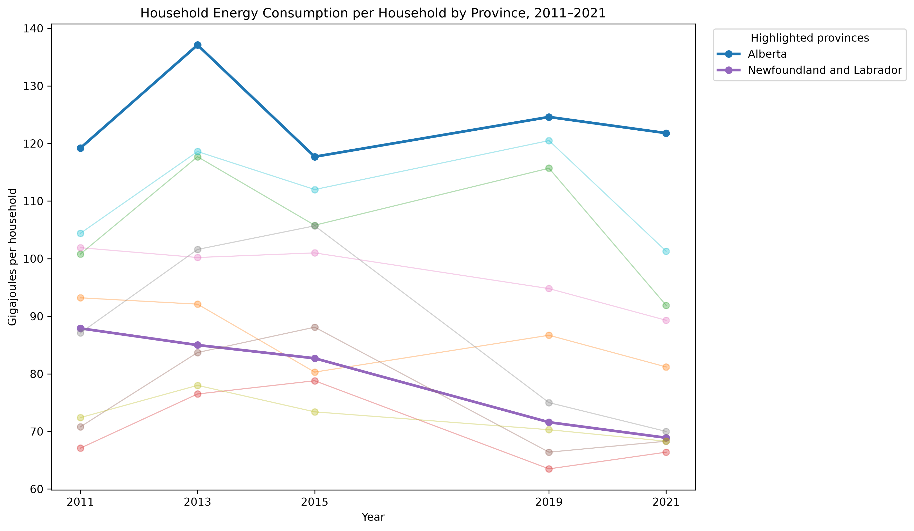
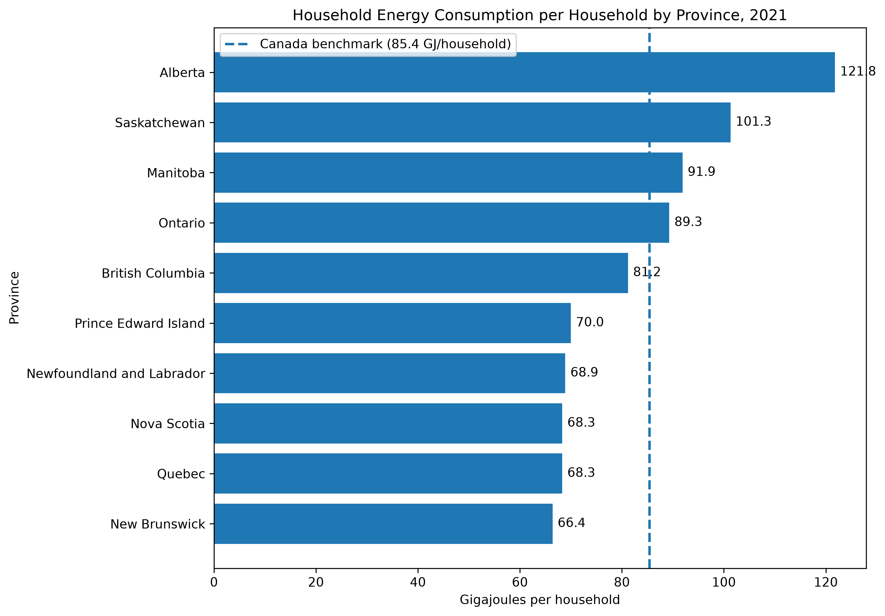
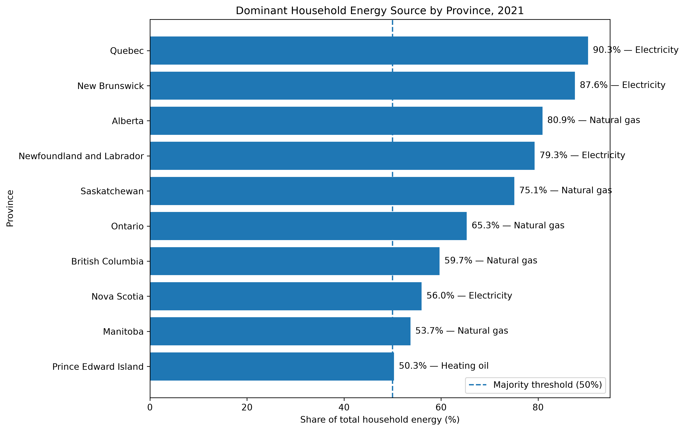
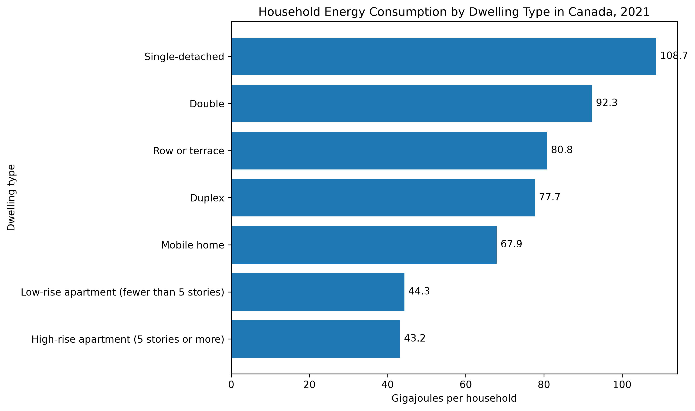
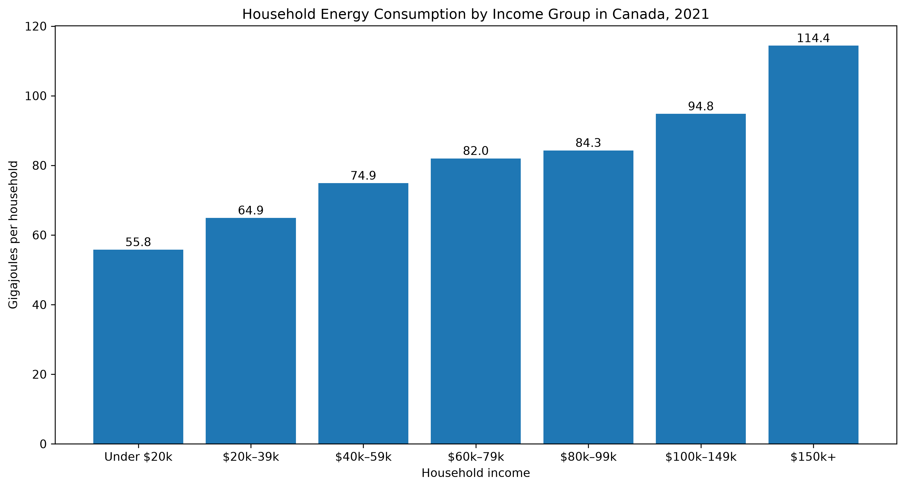

# Canadian Household Energy Consumption Analysis

A PostgreSQL and Python portfolio project analyzing how household energy consumption differs across **Canadian provinces, energy sources, dwelling types, and household-income groups**.

The project uses official Statistics Canada household-energy data and demonstrates an end-to-end analytical workflow spanning **database design, data validation, SQL analysis, Python visualization, and evidence-based interpretation**.

---

## Project Objective

The objective of this project was to build a reproducible analytical workflow using real-world energy data while developing and demonstrating practical skills relevant to energy and data analyst roles.

Rather than treating SQL as a standalone querying exercise, the project follows the full analytical process:

**source inspection → database design → raw-data loading → validation → profiling → clean analytical views → SQL analysis → Python visualization → interpretation**

Gigajoules per household (**GJ/household**) is used as the primary comparison metric because it normalizes energy consumption for differences in household counts and allows more meaningful comparisons across provinces and household groups.

The project addresses five analytical questions:

1. How did household energy consumption per household change across Canadian provinces over the available 2011–2021 observations?
2. How did provinces compare in 2021, and how did each compare with the national benchmark?
3. How did household energy-source patterns differ across provinces in 2021?
4. How did household energy consumption differ across dwelling types in Canada in 2021?
5. How did household energy consumption differ across household-income groups in Canada in 2021?

---

## Project Scope and Data Currency

This project was developed primarily as a **portfolio and skills-development analysis** using official Statistics Canada data. Its purpose is to demonstrate a defensible, reproducible analytical workflow rather than provide a real-time estimate of current Canadian household energy consumption.

As of **November 2026**, the latest reference year available in the Statistics Canada household-energy tables selected for this project is **2021**:

- **Table 25-10-0060-01** — Household energy consumption, Canada and provinces
- **Table 25-10-0061-01** — Household energy consumption, by type of dwelling
- **Table 25-10-0062-01** — Household energy consumption, by household income

The 2021 observations were released by Statistics Canada in 2024. The use of 2021 as the endpoint therefore reflects the availability of comparable observations in the selected source tables rather than an arbitrary decision to exclude newer data.

The project was designed as a reproducible workflow. If newer comparable observations become available in these tables, the raw-data loading, validation, SQL analysis, and notebook workflow can be refreshed using the updated source data, subject to any future changes in Statistics Canada's table structure, definitions, or methodology.

The findings presented here should therefore be interpreted as **descriptive results for the available reference period**, not as estimates of current household energy consumption in 2026.

---

## Key Findings

### 1. Most provinces finished below their 2011 consumption levels

Nine of the ten provinces recorded lower household energy consumption per household in 2021 than in 2011.

**Alberta was the only province to finish above its 2011 level.**

The paths between those endpoints varied considerably. Because observations are available only for 2011, 2013, 2015, 2019, and 2021, the analysis describes changes across observed intervals rather than continuous annual trends.



---

### 2. Provincial household energy consumption differed substantially in 2021

Household energy consumption ranged from:

- **121.8 GJ/household in Alberta**
- to **66.4 GJ/household in New Brunswick**

This produced a provincial spread of **55.4 GJ/household**.

The national Statistics Canada benchmark was **85.4 GJ/household**. Four provinces recorded consumption above that level and six were below it.



---

### 3. Household energy-source patterns varied strongly by province

Natural gas represented more than half of total household energy consumption in **five provinces**, electricity in **four**, and heating oil narrowly exceeded 50% in **Prince Edward Island**.

Among published fuel-intensity observations:

- Quebec recorded the highest electricity consumption per household.
- Newfoundland and Labrador recorded the highest heating-oil consumption per household.
- Alberta recorded the highest natural-gas consumption per household.

Some natural-gas and heating-oil observations were suppressed by Statistics Canada, so fuel-specific comparisons are limited to published observations.



---

### 4. Dwelling type was associated with large differences in household energy consumption

At the Canada level in 2021:

- **Single-detached:** 108.7 GJ/household
- **High-rise apartment:** 43.2 GJ/household

The difference was **65.5 GJ/household**.

The single-detached value was approximately **2.5 times** the high-rise apartment value.



---

### 5. Household energy consumption increased across successive income groups

Household energy consumption increased across every successive published household-income bracket in the 2021 Canada-level data.

Consumption rose from:

- **55.8 GJ/household** for households earning under CAD 20,000
- to **114.4 GJ/household** for households earning CAD 150,000 or more

The highest-income category therefore recorded approximately **2.05 times** the consumption per household of the lowest-income category.

This is a descriptive association and should not be interpreted as evidence that household income itself causes higher energy consumption.



---

## Analytical Workflow

The project follows a layered PostgreSQL architecture:

```text
Statistics Canada CSV files
        ↓
raw schema
        ↓
validation and profiling
        ↓
clean schema
        ↓
analytical SQL
        ↓
Python / Jupyter
        ↓
visualizations and findings
```

### Raw Layer

The `raw` schema preserves source fields and Statistics Canada metadata as closely as practical.

Source observations are retained even when values are unavailable or carry data-quality flags.

### Clean Layer

The `clean` schema exposes analyst-friendly views containing:

- readable column names
- analytical dimensions
- measurement units
- observation values
- quality-status fields
- Statistics Canada vector identifiers for traceability

Cleaning does not mean deleting inconvenient observations. Suppressed or flagged values are retained so data-quality limitations remain visible to the analyst.

### Analysis

Analytical SQL is stored separately from database setup and validation logic.

Techniques used throughout the project include:

- Common Table Expressions (`WITH`)
- window functions
- `LAG()`
- `RANK()`
- `PARTITION BY`
- conditional aggregation
- `CASE`
- aggregate `FILTER`
- benchmark comparison using `CROSS JOIN`
- absolute and percentage-change calculations
- duplicate and grain validation
- data-quality profiling

---

## Data Validation and Quality Handling

Validation was treated as a **dataset-specific analytical process**, not a fixed checklist.

Checks included:

- source-to-database row-count reconciliation
- candidate-grain duplicate detection
- raw-to-clean row preservation
- measurement and metadata profiling
- quality-status distributions
- statistical-series coverage
- validation of the exact data slices used for analysis

### `F` observations

Values marked `F` were treated as **suppressed or unavailable**, not as zero.

### `E` observations

Published values marked `E` were retained but interpreted cautiously.

### Unequal Series Coverage

Not every statistical series contains observations for all five study years.

For example, the household-income category **Income not stated** appears in 2011, 2013, and 2015 but is absent from 2019 and 2021.

Validation rules therefore reflect the actual structure of each source dataset rather than assuming that every statistical vector must contain five observations.

---

## Repository Structure

```text
canadian-household-energy-sql/
│
├── README.md
├── requirements.txt
├── .gitignore
│
├── data/
│   └── README.md
│
├── notebooks/
│   └── household_energy_analysis.ipynb
│
├── outputs/
│   └── figures/
│       ├── 01_historical_provincial_trends.png
│       ├── 02_2021_provincial_comparison.png
│       ├── 03_dominant_energy_source_by_province.png
│       ├── 04_dwelling_type_energy_consumption.png
│       └── 05_income_energy_consumption.png
│
└── sql/
    ├── 00_schema_setup.sql
    ├── 01_raw_overall.sql
    ├── 02_raw_validation.sql
    ├── 03_raw_profiling.sql
    ├── 04_clean_overall.sql
    ├── 05_clean_validation.sql
    ├── 06_dwelling_pipeline.sql
    ├── 07_income_pipeline.sql
    │
    └── analysis/
        ├── 01_historical_trends.sql
        ├── 02_2021_provincial_comparison.sql
        ├── 03_energy_source_patterns.sql
        ├── 04_dwelling_type_analysis.sql
        └── 05_income_analysis.sql
```

---

## Tools and Technologies

**Database**
- PostgreSQL
- DBeaver

**Analysis**
- SQL
- Python
- pandas
- SQLAlchemy

**Visualization**
- Matplotlib

**Documentation**
- Jupyter Notebook
- Markdown

**Version Control**
- Git
- GitHub

---

## Reproducing the Project

### 1. Create a Python virtual environment

```bash
python3 -m venv .venv
source .venv/bin/activate
```

### 2. Install dependencies

```bash
pip install -r requirements.txt
```

### 3. Create the PostgreSQL schemas

Run:

```text
sql/00_schema_setup.sql
```

The project uses the `raw`, `clean`, and `analysis` schemas.

### 4. Obtain the source data

The project uses Statistics Canada tables:

```text
25-10-0060-01
25-10-0061-01
25-10-0062-01
```

Raw source CSV files are intentionally excluded from version control.

Additional source-data information is documented in:

```text
data/README.md
```

### 5. Load and validate the datasets

Database definitions and validation logic are documented in:

```text
sql/01_raw_overall.sql
sql/02_raw_validation.sql
sql/03_raw_profiling.sql
sql/04_clean_overall.sql
sql/05_clean_validation.sql
sql/06_dwelling_pipeline.sql
sql/07_income_pipeline.sql
```

### 6. Configure local database credentials

Create a `.env` file in the project root:

```text
PGHOST=localhost
PGPORT=5432
PGDATABASE=canadian_household_energy
PGUSER=your_postgres_user
PGPASSWORD=your_postgres_password
```

The `.env` file is excluded from version control.

### 7. Launch Jupyter

```bash
jupyter lab
```

Open:

```text
notebooks/household_energy_analysis.ipynb
```

The finished notebook has been tested from a fresh kernel and runs sequentially from the database connection through all five analytical sections.

---

## Data Source and Scope

Data used in this project comes from Statistics Canada household-energy tables 25-10-0060-01, 25-10-0061-01, and 25-10-0062-01.

The clean database views retain Statistics Canada vector identifiers to support traceability between analytical outputs and the underlying statistical series.

The source definition of total household energy consumption in these tables covers **electricity, natural gas, and heating oil**. Other household energy sources such as propane, wood, coal, and other sources are outside the scope of the selected data.

Raw source files are intentionally excluded from the repository.

---

## Interpretation and Limitations

The analysis is descriptive.

Important limitations include:

- only five published observations used in the historical analysis: 2011, 2013, 2015, 2019, and 2021
- unequal intervals between those observations
- suppressed natural-gas and heating-oil observations
- some published estimates carrying `E` quality flags
- unequal historical coverage across some supplementary statistical series
- dwelling and income analyses based on Canada-level 2021 observations
- total household energy in the selected tables being limited to electricity, natural gas, and heating oil
- no multivariable or causal modelling

The provincial, fuel, dwelling-type, and income analyses were conducted separately.

The findings therefore document observed patterns and associations but do not estimate causal effects or determine how these factors jointly influence household energy consumption.

---

## Project Takeaway

This project demonstrates an end-to-end analytical workflow rather than SQL querying in isolation.

It combines database preparation, source validation, analytical SQL, reproducibility, visualization, and careful interpretation of official energy data.

The resulting analysis shows substantial differences in Canadian household energy consumption depending on the dimension being examined while also demonstrating why normalization, data quality, source limitations, and analytical scope matter when interpreting energy data.
